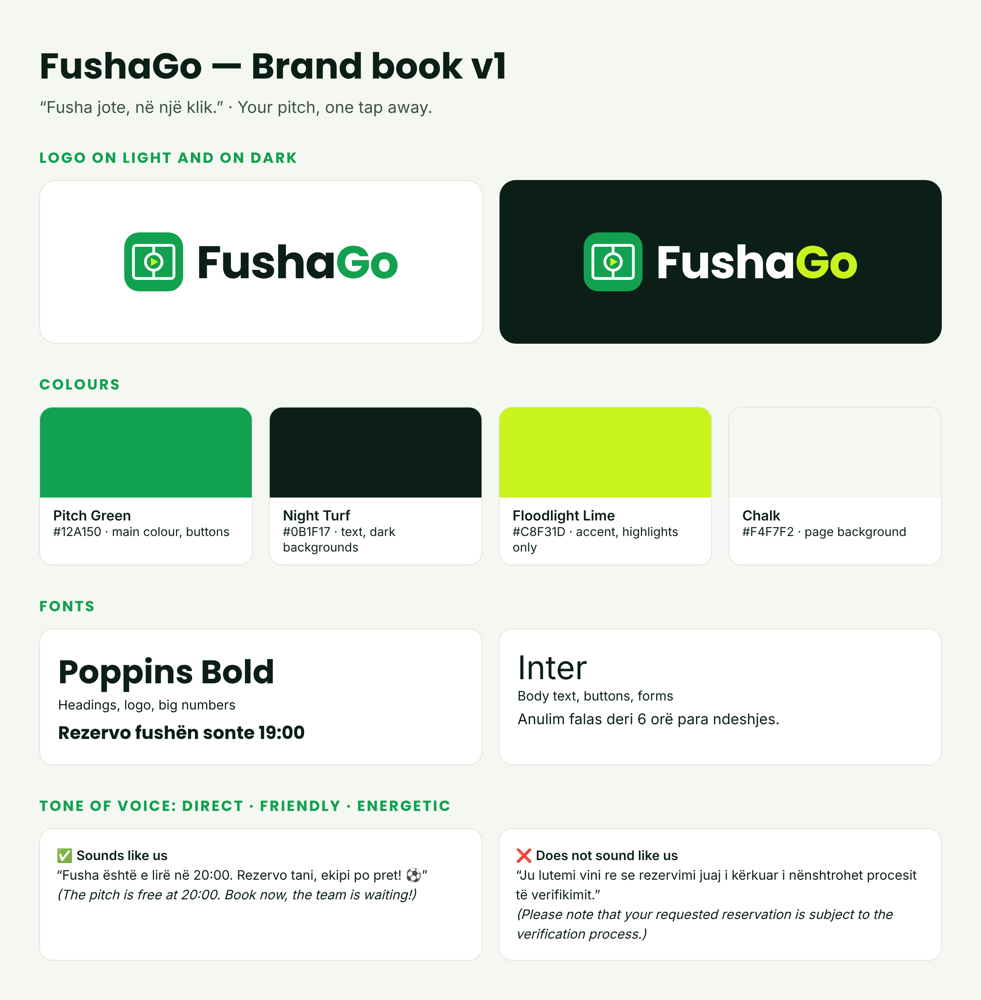

# FushaGo ⚽

**Book a 5-a-side football pitch near you in 30 seconds, with no phone calls and no lost slots.**

FushaGo is a mobile-first web app for players and pitch owners in Kosovo and North Macedonia. Players see free slots and book instantly; owners manage bookings from their phone and stop losing money to no-shows.

## Docs
| File | What's inside |
|---|---|
| [docs/business.md](docs/business.md) | Parts 1–4: problem, big picture, market, business model and price |
| [docs/brand-book.md](docs/brand-book.md) | Part 5: name, tagline, logo, colours, fonts, tone of voice |
| [docs/brand/](docs/brand/) | Logo files (SVG + PNG) and one-page brand board |
| [docs/rules-and-flows.md](docs/rules-and-flows.md) | Part 6: roles, main flows, business rules, what v1 will NOT do |

