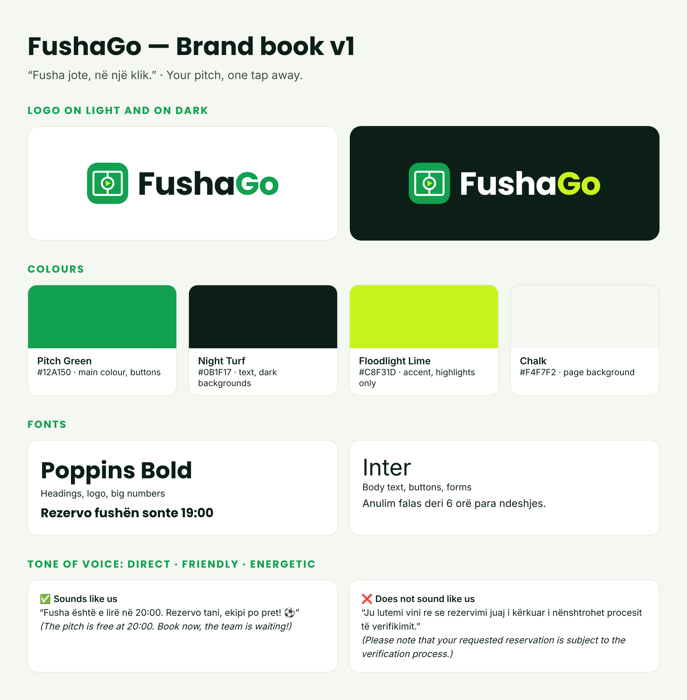

# FushaGo — Brand book v1 (Part 5)

## Name
**FushaGo**: *"fusha"* is Albanian for "pitch/field", and *"Go"* means let's play. It's short, easy to say in Albanian, Macedonian and English, and tells you what the product is about.

**Availability check**

| Item | Name | Status |
|---|---|---|
| Domain | `fushago.app` (backup: `fushago.com`, `fushago.net`) | ⚠️ **To check** on a domain registrar (e.g. Namecheap). The build session had no internet access to registrar sites. |
| Instagram | `@fushago` (backup: `@fushago.app`, `@fushago_ks`) | ⚠️ **To check** by searching in the Instagram app. |

*If `fushago` is taken, use the backups above or the alternative name **"LuajTani"** ("Play now").*

## Tagline
- **Albanian:** *Fusha jote, në një klik.*
- **English:** *Your pitch, one tap away.*

## Logo
A green rounded square with a **pitch seen from above** (outline + centre line). In the centre circle is a lime **"play" arrow**, which stands for kick-off and "Go".

| File | Use |
|---|---|
| [`brand/logo-icon.svg`](brand/logo-icon.svg) | App icon, favicon, profile picture |
| [`brand/logo-light.svg`](brand/logo-light.svg) · [`.png`](brand/logo-light.png) | Logo on **light** backgrounds |
| [`brand/logo-dark.svg`](brand/logo-dark.svg) · [`.png`](brand/logo-dark.png) | Logo on **dark** backgrounds |
| [`brand/brand-board.png`](brand/brand-board.png) | The whole brand on one page |

**Rules:** don't stretch the logo, don't change its colours, and leave space around it at least as wide as the "o" in "Go".

## Colours

| Name | Hex | Use |
|---|---|---|
| **Pitch Green** | `#12A150` | Main colour: buttons, links, logo |
| **Night Turf** | `#0B1F17` | Text, dark backgrounds |
| **Floodlight Lime** | `#C8F31D` | Accent only: highlights, "free slot" badges. Never for body text on white. |
| Chalk *(neutral)* | `#F4F7F2` | Page background |

## Fonts (free, Google Fonts)
- **Poppins Bold (700) / SemiBold (600):** headings, logo, big numbers, prices.
- **Inter Regular (400) / SemiBold (600):** body text, buttons, forms.

## Tone of voice: **Direct · Friendly · Energetic**
We talk like a teammate, not like a bank. Short sentences, clear times and prices, a bit of football energy.

- ✅ **Sounds like us:** "Fusha është e lirë në 20:00. Rezervo tani, ekipi po pret! ⚽" *(The pitch is free at 20:00. Book now, the team is waiting!)*
- ❌ **Does not sound like us:** "Ju lutemi vini re se rezervimi juaj i kërkuar i nënshtrohet procesit të verifikimit." *(Please note that your requested reservation is subject to the verification process.)*
