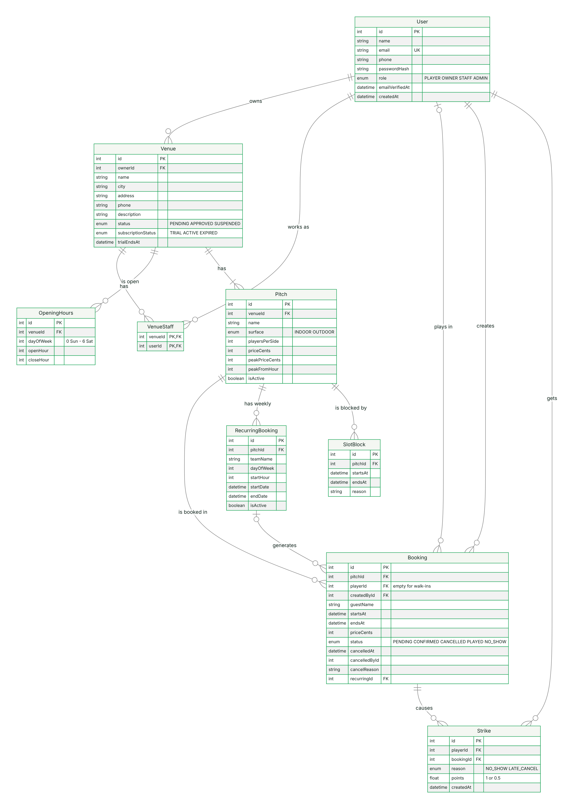
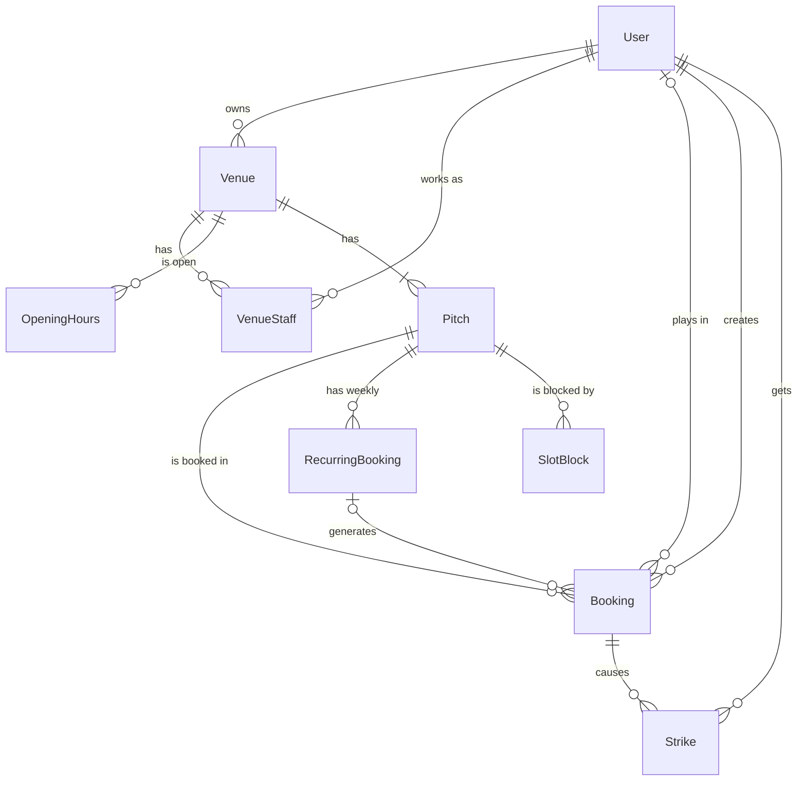

# FushaGo — Data model

These are the things FushaGo stores. They come from the roles, flows and rules in [rules-and-flows.md](rules-and-flows.md).
The real source is [`backend/prisma/schema.prisma`](../backend/prisma/schema.prisma); the tables were created by the first migration in `backend/prisma/migrations/`.



## The models in plain words

| Model | What it is | Links to |
|---|---|---|
| **User** | Anyone with an account. `role` says if they are a PLAYER, OWNER, STAFF or ADMIN. | owns Venues, makes Bookings, gets Strikes |
| **Venue** | A sports centre. Starts as `PENDING` until an admin approves it; has a subscription status (TRIAL / ACTIVE / EXPIRED). | belongs to one owner (User), has Pitches, OpeningHours, Staff |
| **VenueStaff** | Connects a STAFF user to the venue they work at. | Venue + User |
| **OpeningHours** | When a venue is open, one row per day of the week (e.g. Monday 16–24). | Venue |
| **Pitch** | One football pitch inside a venue, with its normal price and optional evening (peak) price. | Venue, has Bookings, RecurringBookings, SlotBlocks |
| **Booking** | One reserved hour on one pitch. Saves the price at the moment of booking. Status: PENDING, CONFIRMED, CANCELLED, PLAYED, NO_SHOW. | Pitch, player (User, empty for walk-ins), creator (User), maybe a RecurringBooking |
| **RecurringBooking** | A team that plays every week at the same time ("every Tuesday 20:00"). | Pitch, creates Bookings |
| **SlotBlock** | Time the owner closed a pitch (maintenance, tournament). | Pitch |
| **Strike** | A penalty: 1 point for a no-show, 0.5 for a late cancellation. | the player (User) and the Booking it came from |

## Which rule lives where

| Rule (from rules-and-flows.md) | Where in the data |
|---|---|
| 1. Slots are 1 hour, within opening hours | `Booking.startsAt` / `endsAt`, `OpeningHours` |
| 2. One booking per pitch per slot | Checked in code before saving (index on `Booking.pitchId + startsAt`). Cancelled bookings must not block a slot, so this is not a database "unique" rule. |
| 6–7. No-shows, strikes, 2 points in 60 days | `Booking.status = NO_SHOW`, `Strike.points`, `Strike.createdAt` |
| 9. Price changes don't affect existing bookings | `Booking.priceCents` is copied from the pitch when booked |
| 10. Owners can block slots | `SlotBlock` |
| 11. Email must be confirmed | `User.emailVerifiedAt` |
| 13. Venue visible only when approved and subscribed | `Venue.status`, `Venue.subscriptionStatus` |

Money is stored in **euro cents** as whole numbers (`2500` = €25.00) to avoid rounding errors.

## Same diagram as code

GitHub draws this automatically:



## For dbdiagram.io

Paste this at [dbdiagram.io](https://dbdiagram.io/d) to see and edit the diagram there:

```dbml
Table User {
  id int [pk, increment]
  name varchar
  email varchar [unique]
  phone varchar
  passwordHash varchar
  role varchar [note: 'PLAYER, OWNER, STAFF, ADMIN']
  emailVerifiedAt datetime
  createdAt datetime
}

Table Venue {
  id int [pk, increment]
  ownerId int [ref: > User.id]
  name varchar
  city varchar
  address varchar
  phone varchar
  description varchar
  status varchar [note: 'PENDING, APPROVED, SUSPENDED']
  subscriptionStatus varchar [note: 'TRIAL, ACTIVE, EXPIRED']
  trialEndsAt datetime
  createdAt datetime
}

Table VenueStaff {
  venueId int [pk, ref: > Venue.id]
  userId int [pk, ref: > User.id]
}

Table OpeningHours {
  id int [pk, increment]
  venueId int [ref: > Venue.id]
  dayOfWeek int [note: '0 = Sunday ... 6 = Saturday']
  openHour int
  closeHour int
}

Table Pitch {
  id int [pk, increment]
  venueId int [ref: > Venue.id]
  name varchar
  surface varchar [note: 'INDOOR, OUTDOOR']
  playersPerSide int
  priceCents int
  peakPriceCents int
  peakFromHour int
  isActive boolean
}

Table Booking {
  id int [pk, increment]
  pitchId int [ref: > Pitch.id]
  playerId int [ref: > User.id, note: 'empty for walk-ins']
  createdById int [ref: > User.id]
  guestName varchar
  startsAt datetime
  endsAt datetime
  priceCents int
  status varchar [note: 'PENDING, CONFIRMED, CANCELLED, PLAYED, NO_SHOW']
  cancelledAt datetime
  cancelledById int
  cancelReason varchar
  recurringId int [ref: > RecurringBooking.id]
  createdAt datetime
}

Table RecurringBooking {
  id int [pk, increment]
  pitchId int [ref: > Pitch.id]
  teamName varchar
  dayOfWeek int
  startHour int
  startDate datetime
  endDate datetime
  isActive boolean
}

Table SlotBlock {
  id int [pk, increment]
  pitchId int [ref: > Pitch.id]
  startsAt datetime
  endsAt datetime
  reason varchar
}

Table Strike {
  id int [pk, increment]
  playerId int [ref: > User.id]
  bookingId int [ref: > Booking.id]
  reason varchar [note: 'NO_SHOW, LATE_CANCEL']
  points float [note: '1 or 0.5']
  createdAt datetime
}
```
